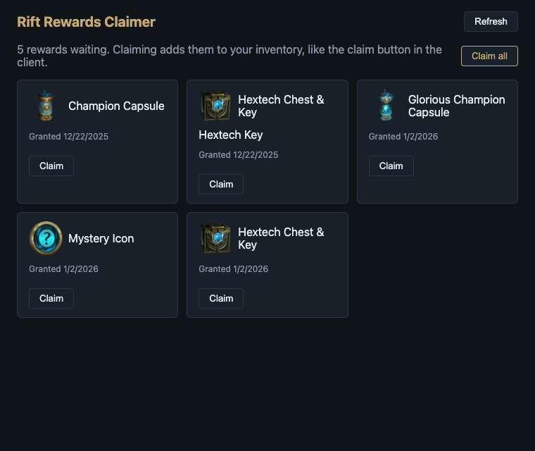

# Rift Rewards Claimer

A small desktop app that lists and claims the League of Legends rewards waiting for
your account. It reads your own League client through its local API, the same one
the client uses.

Under development.

Parent project: [Rift Explorer Remastered](https://github.com/LongpanZhou/rift-explorer-remastered),
a rewrite of [Pupix/rift-explorer](https://github.com/Pupix/rift-explorer). This app is
the rewards part of that project, split out as its own app.

## How League rewards work

League grants rewards to your account: Hextech chests and keys, champion and
Glorious capsules, icons and similar items. The client's rewards service stores each
one as a *grant*. A grant that has more than one possible reward shows a choice, and
the grant waits in the `PENDING_SELECTION` state until you pick one and claim it.

Some of these grants can't be claimed from the in-game Rewards screen. This app
finds the grants that are waiting, and claims them through the client's local API
(`/lol-rewards/v1/grants/{id}/select`). It works like the claim button, but it can
claim many grants at once.

When it was tested on a real account, five grants were waiting: a Champion Capsule,
a Glorious Champion Capsule, a Mystery Icon, and two Hextech Chest & Key grants.
They were all claimed with **Claim all**.

## Screenshot

This is the app showing sample rewards, using the same kinds of rewards that were
waiting on the test account. Real rewards are listed the same way.

## What it does

- Lists the rewards waiting to be claimed, with item pictures and when each was granted.
- **Claim** claims one reward. **Claim all** claims every reward that doesn't need a choice.
- A reward that asks you to pick an item is left for the client, so the app never picks for you.
- Each claim asks for a second click, because a claim cannot be undone.

## Requirements

- The League of Legends client, running and logged in.
- macOS or Windows. The League client does not run on Linux, so the app cannot connect there.

## Releases

Installers for macOS (Apple Silicon), Windows and Linux are published under
[Releases](https://github.com/LongpanZhou/rift-rewards-claimer/releases) when a version
tag is pushed. The builds are unsigned, so your system may ask you to confirm before
opening them.

## Notes

- The League client's local API is not officially supported for third-party tools,
  and Riot can change it at any time.
- Claiming rewards changes your account. Check what a reward is before you claim it.
